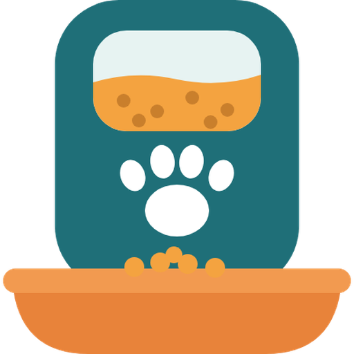

<p align="center"></p>

# Pawsync Feeder pour Home Assistant

*[English version](README.md)*

Intégration Home Assistant pour les distributeurs de croquettes connectés **Pawsync**, avec sa propre carte de
tableau de bord. Testée avec le **PPF-R361S-WEU** (`VS_WB_PFM_PPF-R361S-WEU_EU`) ; les autres distributeurs
Pawsync utilisant la même API cloud devraient fonctionner aussi.

Elle repose sur le protocole cloud découvert par la communauté
([jasonmeisel/pawsync-hass](https://github.com/jasonmeisel/pawsync-hass),
[smcneece/pawsync-hass](https://github.com/smcneece/pawsync-hass), licence MIT), entièrement réécrit.

> Ce projet n'est ni affilié à Pawsync ou VeSync, ni approuvé par eux.

## Points forts

| | pawsync-hass | Pawsync Feeder |
|---|---|---|
| Client API | état global partagé entre comptes | un client par compte, sans état global |
| Jeton expiré | reconnexion à certains endroits | reconnexion et nouvel essai automatiques sur **chaque** appel |
| Mot de passe changé | erreurs dans les journaux | flux de **ré-authentification** HA |
| Fuseau / pays | `America/Los_Angeles`, `US` en dur | pris dans la config HA (totaux « aujourd'hui » justes) |
| Unités | bascule maison US / métrique | grammes natifs, conversion HA standard par entité |
| Noms | anglais uniquement | traduits (**français**, **anglais**) |
| Requêtes | en série | statuts, journaux et animaux en parallèle ; firmware toutes les 6 h |
| Firmware | capteur binaire | entité **update** native |
| Événements | — | entité **event** (repas programmé, repas supplémentaire, animal a mangé) |
| Diagnostics | — | téléchargeables, données personnelles masquées |
| Action `feed` | cible un capteur | cible un **appareil**, quantité en grammes |
| Tableau de bord | — | **carte intégrée**, enregistrée automatiquement |

## Entités (par distributeur)

- **Capteurs** : croquettes dans la gamelle (balance en direct), niveau du réservoir, croquettes restantes,
  autonomie (jours), déshydratant (jours), prochain repas (horodatage) et quantité, total programmé, dernière
  distribution et quantité, distribué aujourd'hui, dernier repas mangé, quantité et durée, mangé aujourd'hui,
  alertes ; pour l'animal lié : poids, consommation du jour, objectif, nombre de repas.
- **Capteurs binaires** : en ligne, gamelle (problème si retirée), alimentation secteur, déshydratant épuisé.
- **Boutons** : repas supplémentaire, appel du repas, tarer la balance, réinitialiser le déshydratant.
- **Interrupteurs** : distribution intelligente, distribution lente, mode précision, mode nuit.
- **Heures** : début / fin du mode nuit.
- **Nombres** : portion du repas supplémentaire (g, stockée localement), remplissage du réservoir après recharge (ml).
- **Événement** : `feeding` (types `scheduled_meal`, `extra_meal`, `eaten`, avec la quantité).
- **Mise à jour** : firmware (information seulement, l'installation se fait depuis l'app Pawsync).

## Installation

### HACS (recommandé)

1. Dans HACS, menu **⋮** → **Dépôts personnalisés**.
2. Ajoutez `https://github.com/globoudou/pawsync_feeder`, type **Intégration**.
3. Cherchez **Pawsync Feeder** puis **Télécharger**.
4. Redémarrez Home Assistant.

### Manuelle

Copiez `custom_components/pawsync_feeder` dans le dossier `config/custom_components/` de Home Assistant, puis redémarrez.

### Configuration

**Paramètres → Appareils et services → Ajouter une intégration → Pawsync Feeder**, avec les identifiants de
l'app Pawsync. L'intervalle d'interrogation (5 minutes par défaut) se règle dans les options de l'intégration.

Home Assistant 2025.8 ou plus récent est requis. L'icône de l'intégration s'affiche à partir de Home Assistant 2026.3.

## Carte de tableau de bord

L'intégration fournit sa propre carte et l'ajoute automatiquement aux ressources des tableaux de bord (mode
« stockage », le mode par défaut). Après une mise à jour, fermez complètement puis rouvrez l'appli.

**Modifier le tableau de bord → Ajouter une carte →** cherchez **Pawsync Feeder**. La carte trouve seule les
entités du distributeur et affiche : niveaux du réservoir et de la gamelle, alertes (hors ligne, gamelle retirée,
déshydratant), prochain et dernier repas, totaux du jour, bouton **Nourrir** avec confirmation, portion, appel du
repas et mode nuit.

```yaml
type: custom:pawsync-feeder-card
# device: <id de l'appareil>   # facultatif si vous n'avez qu'un distributeur
# title: Croquettes            # facultatif
```

Si la carte affiche « Custom element doesn't exist », ajoutez la ressource à la main : activez le **mode avancé**
dans votre profil, puis **Paramètres → Tableaux de bord → ⋮ → Ressources → Ajouter une ressource**, URL
`/pawsync_feeder/pawsync-feeder-card.js`, type **Module JavaScript**.

## Actions

`pawsync_feeder.feed` — distribue immédiatement un repas supplémentaire.

```yaml
action: pawsync_feeder.feed
data:
  device_id: <id de votre distributeur>
  amount: 11   # grammes, facultatif (par défaut : la portion du repas supplémentaire)
```

## Exemple d'automatisation

```yaml
triggers:
  - trigger: state
    entity_id: event.mon_distributeur_repas
    attribute: event_type
    to: eaten
actions:
  - action: notify.mobile_app_mon_telephone
    data:
      message: "Le chat a mangé {{ trigger.to_state.attributes.amount }} g"
```

## Limites connues

- API cloud non officielle : Pawsync peut la modifier sans préavis.
- La capacité du réservoir est supposée de 3,6 L (utilisée pour convertir le pourcentage de remplissage).
- Tous les appels passent par `smartapi.pawsync.com`, l'hôte utilisé par l'app (fonctionne aussi pour les comptes européens).
- Les interrupteurs changent d'état immédiatement ; si le cloud ne confirme pas, l'état réel revient au rafraîchissement suivant.

## Dépannage

Téléchargez les diagnostics depuis le menu **⋮** de l'intégration (identifiants et données personnelles masqués)
et joignez-les à un [ticket](https://github.com/globoudou/pawsync_feeder/issues).

## Développement

```bash
pip install pytest-homeassistant-custom-component
pytest tests
```
